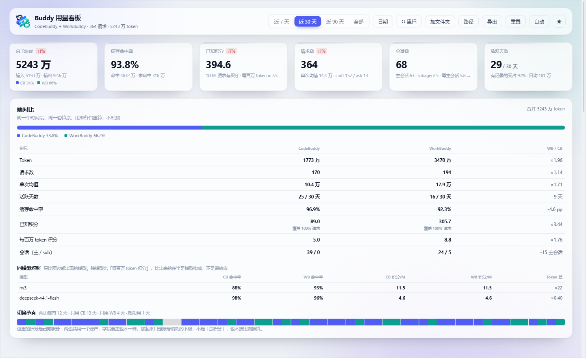
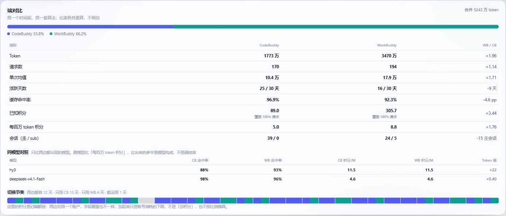
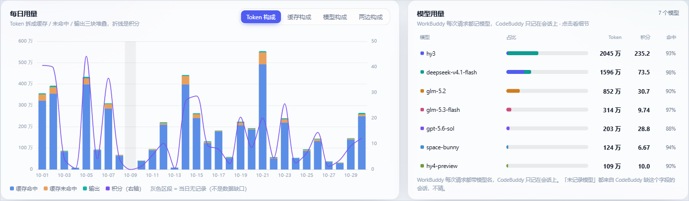
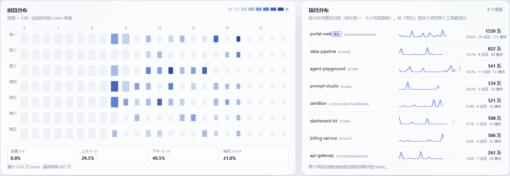
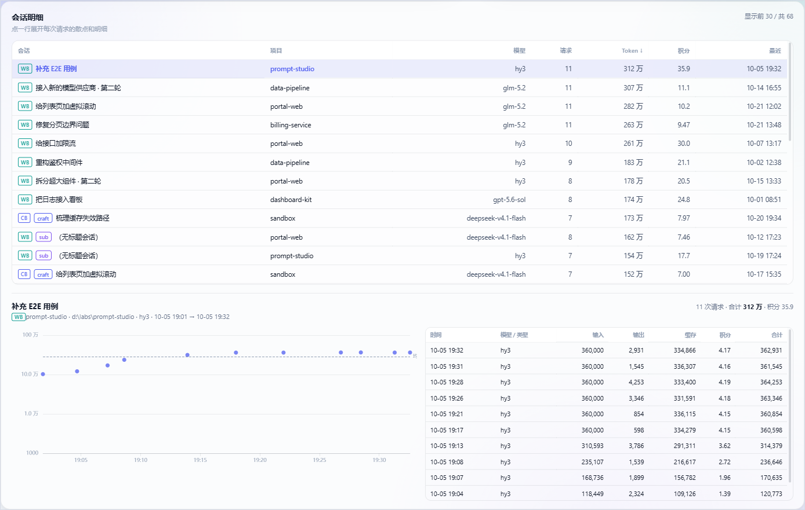
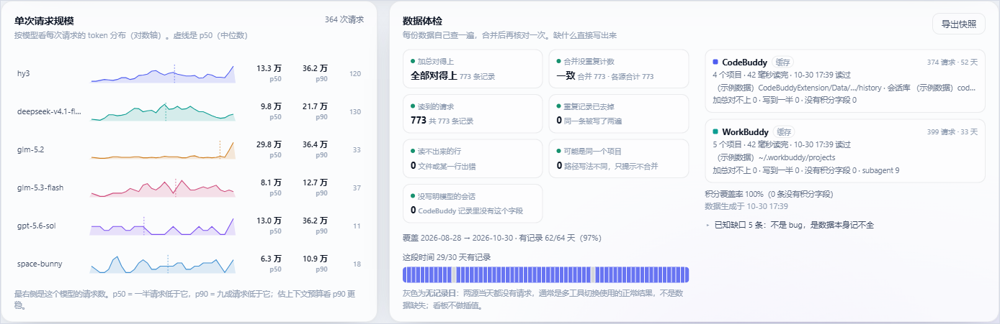
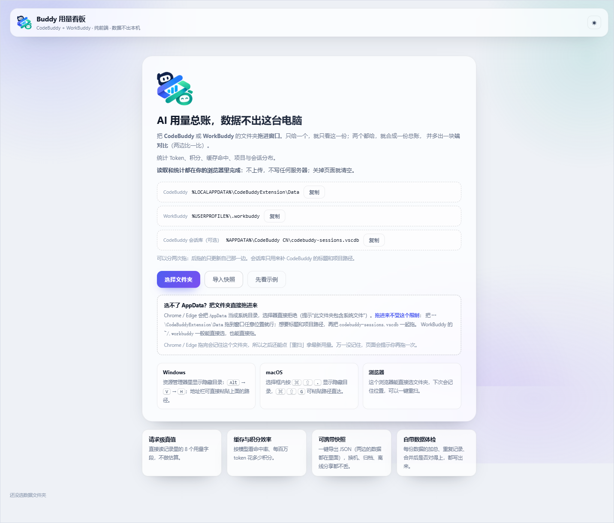
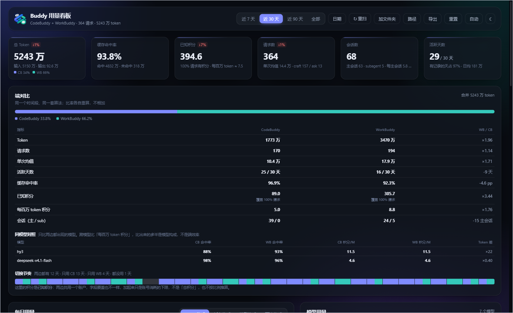

<div align="center">

# Buddy 用量看板

**把 CodeBuddy、WorkBuddy 留在本机的用量记录，读成一份逐请求可核对的总账。**

<sub>纯前端 · 零上传 · 单文件产物 · 数据不出这台电脑</sub>

[](https://875778261.github.io/codebuddy-token-dashboard/)


[](LICENSE)



</div>

## 它回答什么

- 这段时间一共用了多少 token、多少积分？缓存命中率多少？
- 哪个项目、哪个模型最费钱？一天里几点用得最狠？
- CodeBuddy 和 WorkBuddy 谁更费、单次请求谁更重、两边切换是什么节奏？
- 拿数字去对账时，差的那部分是**数据缺失**还是**口径不同**？（数据体检逐条说明）

数据来自本机已有的文件，不是自己埋点采集的：

| 数据源 | 读什么 | 说明 |
|---|---|---|
| **CodeBuddy** | `history/**/index.json` | 逐请求 usage；可选 `codebuddy-sessions.vscdb` 补会话标题与项目路径 |
| **WorkBuddy** | `~/.workbuddy/projects/**/*.jsonl`（含 `subagents/`） | 逐请求 usage 与积分都来自 jsonl |

只给一端，就只看这一份；两端都给，就合成一份总账，并多出一块**端对比**（两边比一比）。token 直接相加（实测零重叠），比率各自用合并后的分子分母重算。

## 快速开始

```bash
npm install
npm run dev          # http://localhost:5173
npm run build        # 产出单个 dist/index.html（不到 1 MB，可离线双击打开）
```

不想装任何东西，先看效果：打开 <https://875778261.github.io/codebuddy-token-dashboard/>，点「先看示例」——那是合成的示例用量，不含任何真实路径。

进页面后有两种给数据的办法：

| 方式 | 操作 | 适用 |
|---|---|---|
| **拖入**（推荐） | CodeBuddy：把 `%LOCALAPPDATA%\CodeBuddyExtension\Data` 拖进窗口；要标题与项目路径，再把 `%APPDATA%\CodeBuddy CN\codebuddy-sessions.vscdb` 一起拖进来。WorkBuddy：把 `%USERPROFILE%\.workbuddy`（或其 `projects`）拖进来 | 日常使用；拖完还能「重扫」读新增用量 |
| **快照** | 跑 `npm run collect`，把生成的 `*-usage-*.json` 导入或拖进页面 | 归档、换机、CI，或拖入也不行时 |

页面按**文件形状**识别数据源，不需要提前声明是哪个产品：`history/**/index.json` 归 CodeBuddy，`projects/**/*.jsonl` 归 WorkBuddy，一次拖入两种都能认出来。两端可以分两次拖，后拖的只更新自己那一边。

选过的数据缓存在 IndexedDB，下次打开直接出图；「自动」打开后每 5 分钟静默重扫一次。

<details>
<summary><b>为什么不能直接「选择」AppData（点开）</b></summary>

Chrome / Edge 把 `AppData` 判定为**系统目录**，`showDirectoryPicker()` 与 `<input webkitdirectory>` 的目录选择器会直接拒绝，提示「无法打开此文件夹：由于此文件夹包含系统文件」。这是浏览器的硬限制，与读权限无关（同一路径交给页面读取完全可行，实测 250 ms 扫完）。`codebuddy-sessions.vscdb` 的文件选择器同样会被拦——所以走「拖入」或「快照」。

拖完还能不能「重扫」，取决于浏览器有没有给可持久化目录句柄：Edge / Chrome 实测会给（`DataTransferItem.getAsFileSystemHandle` 拿到 directory handle 并写进 IndexedDB）；只有快照导入、`<input webkitdirectory>` 文件框、示例数据这三条路径没有句柄，顶栏「重扫」会提示改用拖入或「加文件夹」。

**拖入必须通过 `http(s)` 打开页面**（`npm run dev` 或任意静态托管）：`file://` 下浏览器不会为拖入的目录创建文件系统条目，表现是「拖了没反应」。`file://` 场景请用快照导入。

</details>

<details>
<summary><b>踩过的坑（供后来者参考）</b></summary>

- **目录联接（junction）不能拖**：`npm run bridge` 生成的 `cb-bridge` 看似捷径，但 Chrome 对联接目录不返回 `FileSystemEntry`，拖进去等于没拖，扫描结果为 0 条。脚本还留在 `scripts/bridge.mjs`，仅供想手动验证「选择目录能否选联接」的人使用，不作为推荐路径。
- **不要试图用 `file://` + 目录选择**：`showDirectoryPicker` 在部分 `file://` 场景抛 `SecurityError`，界面会回落到文件框，但文件框同样拦 AppData。

</details>

## 界面

**端对比**——两端都读入时才出现，分三层：量差、同模型效率差（只比两端都存在的模型，避免拿模型构成差异当效率差）、切换节奏（逐日「只用 CB / 只用 WB / 都用 / 都没用」）。



| 每日用量 / 模型用量 | 时段分布 / 项目分布 |
|---|---|
|  |  |

**会话明细**——点一行展开这次会话的每次请求：散点看规模分布，右边的表给逐请求的输入、输出、缓存、积分。模型卡片点一下，整个看板就按这个模型过滤。



**数据体检**——每份数据自己查一遍，合并后再核对一次；缺什么直接写出来，而不是藏在脚注里。



首屏是这样的，明暗两个主题都在：

| 开始页 | 深色主题 |
|---|---|
|  |  |

## 指标口径

口径写在这里，是因为这些数字要拿去对账。

| 指标 | 口径 | 数据来源 |
|---|---|---|
| 总 Token / 输入 / 输出 | `usage` 逐条求和（两源直接相加，跨源不去重） | CB history / WB jsonl |
| 缓存命中率 | `Σcache / Σinput`，**合并视图按合并后的分子分母重算** | 同上 |
| 已知积分 | `Σcredit` + 覆盖率（有 credit 字段的请求数 / 全部请求数）；本地无单价表，不换算人民币 | 同上 |
| 请求数 | 以 `usage` 存在为唯一准入条件 | 同上 |
| 会话数 | 主会话与 subagent 分列（WorkBuddy 的 subagent 会话独立存在） | 同上 |
| 模型归属 | **请求级 `model` 优先**（WB），回落会话级 `selectedModelId`（CB）；都缺才归入「未记录模型」 | WB jsonl / CB 项目索引 |
| 会话标题 | WorkBuddy 取 `ai-title`（约 6 成），CodeBuddy 取会话库 | jsonl / vscdb |
| 项目 | 归一化 cwd（`\`→`/`、去尾斜杠，**大小写保留**）；归一后同 key 不同原串只告警，不自动合并 | 同上 |
| 活跃天数 / 无记录日 | 按本地日期聚合；两源都没有请求的日子只作中性留白，不做插值 | 同上 |

两条恒等式在解析期逐条校验并展示在「数据体检」里：

```
inputTokens == cacheTokens + cachedMissTokens (+ cachedWriteTokens)
totalTokens == inputTokens + outputTokens
```

合并后还要额外成立（都展示在「数据体检」）：

```
合并 requests == Σ各源 requests == 实际会话求和     // 防合并层重复计数
归一后同 key 不同原串的项目数 == suspectedDuplicateProjects
```

端对比里的比率字段各自重算，绝不求和；单源视图里的积分只能叫「该端已知积分」。

## 数据体检与已知缺口

看板会明示这些口径限制，而不是把它们藏在脚注里：

- 代码补全（Inline Completion）在扩展日志里只有耗时，没有 token / 积分，永久不可得。
- Inline Chat / 选中代码提问不写 `requests[]`，会少算。
- 云端会话正文不落本地；跨机器需要靠导出的快照合并。
- 扩展日志会轮转，早于首次启动目录的 step 级明细（含 `thinkingTokens`）已丢失。
- 两端共用同一积分账户：合并后的积分只是**账号消耗下限**，与官方账单的差额永远存在，不做比例外推。
- WorkBuddy 首版不读 `workbuddy.db`：会话标题来自 `ai-title`（约 6 成），缺失留空。
- 两源都没有请求的日子是**无记录日**（多工具切换的正常结果），只作中性留白，不当缺口告警。

## 验证

```bash
npm test          # 52 个单元测试：解析、聚合、按源切片、合并、WorkBuddy 解析、快照往返、SQLite 解析、新鲜度
npm run verify    # 真实数据对拍：TS 管线 vs Python 独立实现
npm run lint:copy # 文案门禁：界面可见文案里的禁用词与超长句（规则见 docs/COPY.md；build 前自动跑）
```

`npm run verify` 会跑 `scripts/ground-truth.py`（独立的 Python 实现）与 `scripts/verify-pipeline.ts`（浏览器里跑的那份 TS 代码），逐字段比对请求数、Token、积分、两条恒等式、逐日、逐会话、以及快照往返。任何差异都判定为解析 bug。

本机最近一次对拍：`128 会话 / 674 请求 / 886,086,182 token / 1611.69 积分`，逐日逐会话完全一致（仅作回归基线，不是承诺值）。

## 架构

三个决定撑起了「零上传」：

1. **采集放在浏览器里**（[ADR 0002](docs/adr/0002-pure-frontend-collection.md)）：目录扫描、解析、聚合全在前端完成，没有服务端，也就没有可上传的通道。
2. **自己写了一个只读 SQLite 解析器**（`src/core/sqlite.ts`）：为了不引入 wasm，也不把 `.vscdb` 拷来拷去。
3. **快照 JSON 作为可携带的真值**（[ADR 0003](docs/adr/0003-merge-workbuddy-into-one-dataset.md)）：归档、换机、对拍都用同一份格式。

```
GLOSSARY.md        领域术语表（数据源 / 请求 / 积分 / 无记录日 / 端对比）
src/
  core/            纯函数，可被 Node 与浏览器共用
    sqlite.ts      极简只读 SQLite 解析（表 b-tree + overflow 页）
    parse.ts       CodeBuddy history index.json → Dataset（含自检与覆盖率）
    workbuddyParse.ts  WorkBuddy projects/**/*.jsonl → Dataset（去重 / 全零回落 / subagents）
    merge.ts       切片归一化与合并（路径归一、源前缀、疑似同项目）
    aggregate.ts   时间窗口 / 模型 / 项目 / 时段 / 分布聚合（含按源过滤）
    snapshot.ts    快照序列化与反序列化（v2，兼容 v1）
  platform/        浏览器侧 I/O（目录扫描、拖入扫描、IndexedDB）
  ui/              卡片与图表组件（ECharts + GSAP）
docs/
  codebuddy-ide-data-sources.md  本机数据源勘察报告（口径依据）
  workbuddy-data-sources.md      WorkBuddy 数据源勘察报告（含 token.daeai.cn 口径对拍）
  adr/             架构决策记录
scripts/
  collect.ts       本地采集 → 快照 JSON
  verify-pipeline.ts / ground-truth.py  真值对拍
```

所有指标只有一份聚合实现：按源过滤是**视图**，不是第二条管线（[ADR 0004](docs/adr/0004-source-slices-and-compare.md)）。

## 部署

产物是单个 `dist/index.html`。GitHub Pages 与 Cloudflare Workers 由 push `main` 自动构建；Cloudflare Pages 走本地 `npm run deploy:pages`。

| 入口 | 地址 |
|---|---|
| **GitHub Pages**（演示地址） | <https://875778261.github.io/codebuddy-token-dashboard/> |
| Cloudflare Pages | <https://codebuddy-token-dashboard.pages.dev> |
| Cloudflare Workers | <https://codebuddy-token-dashboard.875778261.workers.dev> |

国内入口还没落地：EdgeOne 默认域名是 3 小时限时预览、裸链接 401，绑上已备案域名才算常驻。构建设置与踩坑记录在 [`docs/deploy.md`](docs/deploy.md)。

## 文档

- [`GLOSSARY.md`](GLOSSARY.md)：领域术语表（数据源、切片、合并视图、端对比、已知积分、无记录日）。
- [`docs/COPY.md`](docs/COPY.md)：界面文案规范与禁用词，`npm run lint:copy` 是它的执行者。
- [`docs/deploy.md`](docs/deploy.md)：部署入口、构建设置、网络实况与踩坑记录。
- [`docs/codebuddy-ide-data-sources.md`](docs/codebuddy-ide-data-sources.md) / [`docs/workbuddy-data-sources.md`](docs/workbuddy-data-sources.md)：两个数据源的勘察报告，所有口径的一手依据。
- [`docs/adr/`](docs/adr/)：架构决策记录，从 [0001](docs/adr/0001-playwright-install-scope.md) 起。
